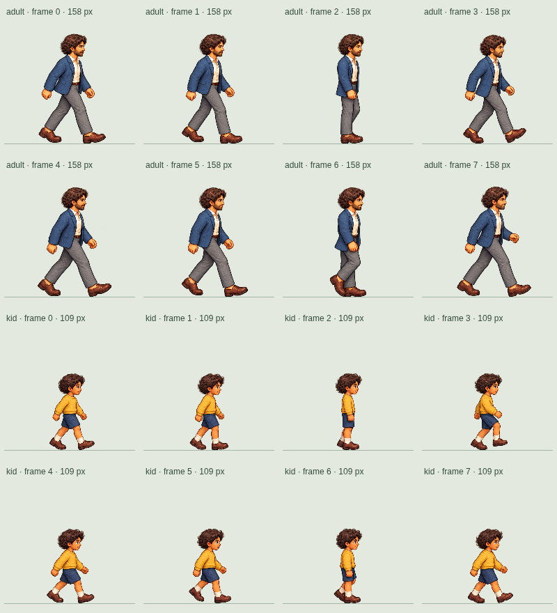

# Original walking pose audit

The game uses the original, unchanged complete-character PNGs:

- `public/art/observer-adult-0-walking.png` — blue-jacket adult.
- `public/art/observer-kid-0-walking.png` — yellow-jumper child.

Both sheets contain eight drawings in four columns and two rows. Playback is
0 → 1 → 2 → 3 → 4 → 5 → 6 → 7 → 0, reading each row left to right.
All eight cells are packaged and displayed. The engine does not omit or reverse
any frames for leftward walking: it flips the complete character horizontally.
Frame timing follows distance traveled at the original walking speeds.

The following numbered sheet uses the actual loaded frames at game size.



## What the drawings still need

Eight frames is enough for a basic two-step walk when the two halves depict
opposite legs performing the same sequence:

| Intended phase | First step | Opposite step |
| --- | --- | --- |
| Contact | 0 | 4 |
| Down / weight acceptance | 1 | 5 |
| Passing | 2 | 6 |
| Up / recovery | 3 | 7 |

These are the intended roles, rather than claims that the existing art fulfills
them. The second row repeats much of the first row's leg overlap and arm swing,
especially in the wide-stride pairs 0/4 and 1/5. The passing poses 2/6 differ,
but the surrounding poses do not consistently establish which leg is nearer
the viewer. The recovery poses 3/7 also need review: wide strides alone do not
show the trailing foot lifting and swinging through.

The remaining issue is therefore missing or inconsistent *opposite-leg poses*,
rather than missing atlas cells. Reordering the existing drawings or adding
interpolations cannot reliably recover the intended leg identities. Keep the
original appearance, make the two step sequences anatomically consistent, and
then consider additional drawn in-betweens. Do not infer correctness from frame
counts, shoe positions, or near/far annotations alone.

The user's [walk-cycle body reference](https://1.bp.blogspot.com/-EhqNikTSBpY/TaY7f_MJY2I/AAAAAAAAA7U/H99z084fOTM/s1600/RW_modified_walk_lesson_07.jpg)
guides contact, down, passing, and up, with opposing arm swing and a consistent
near leg throughout the loop. Art corrections remain for a separate pass.

## Review and rebuild

`/?walkReview=1` starts the original adult and child immediately in both
directions, with the same scale and pace for matching ages. The old
`/?walkCompare=1` link remains an alias. The experimental generated sheets,
interpolation tools, trial speed overrides, and duplicate original atlas have
been removed; the trial remains in Git history.

From the repository root:

```bash
node scripts/build-walking-atlas.mjs
node scripts/review-walking.mjs http://127.0.0.1:5173
```

The builder reads the complete original PNGs and writes only atlas metadata
and gait distances. It applies one shared scale and sole baseline per design.
Browser checks verify that every original drawing is used, its opaque pixels
are retained, and both directions play 0–7 without skips. The review script
exports numbered pose sheets and motion previews from the actual loaded frames.
